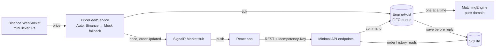

# Paper Trading Platform

A miniature paper-trading platform: trade crypto pairs with virtual money against **live prices**.
.NET 10 backend (matching simulator, portfolio, REST + SignalR) · React frontend (English/Arabic) · Docker · GitHub Actions · Azure.

> **Live demo:** _see "Deployment status" below_ · **API test page:** `<api-url>/scalar`

---

## 1. Quick start

### Option A — Docker (whole app, one command)
```bash
docker compose up --build
```
- Web app: http://localhost:5173
- API test page (Scalar/OpenAPI): http://localhost:5080/scalar

### Option B — Run locally for development
Prerequisites: .NET 10 SDK, Node 24.
```bash
# Terminal 1 — API on http://localhost:5080
dotnet run --project src/PaperTrading.Api

# Terminal 2 — web on http://localhost:5173
cd web
npm install
npm run dev
```

### Tests
```bash
dotnet test            # engine + API tests
cd web && npm run lint && npm run build
```

### Configuration (no secrets required)
All settings are in `src/PaperTrading.Api/appsettings.json` and can be overridden with environment variables
(e.g. `PriceFeed__Mode=Mock`).

| Setting | Default | Meaning |
|---|---|---|
| `PriceFeed:Mode` | `Auto` | `Auto` = Binance, falls back to the mock feed after 3 failures · `Binance` · `Mock` · `None` |
| `Trading:StartingCash` | `100000` | Virtual USDT for each new account |
| `Trading:Instruments` | BTC, ETH, SOL, BNB | Symbol, quantity step, tick size, mock start price |
| `ConnectionStrings:Trading` | `Data Source=trading.db` | SQLite file |
| `Cors:AllowedOrigins` | `http://localhost:5173` | Web app origin(s) |
| `VITE_API_URL` (web, build time) | `http://localhost:5080` | API base URL |

---

## 2. What it does

1. A **price table** updates live (Binance public WebSocket → backend → SignalR → browser).
2. The **order ticket** places **Market** (fill now at the last price) or **Limit** orders (wait until the price reaches the limit).
3. The **portfolio** shows cash, reserved cash, positions, average cost, **realized** and **unrealized P&L**, equity.
4. The **order history** shows every order with its status (`Open`, `Filled`, `Cancelled`, `Rejected` + reason); open limit orders can be cancelled.
5. **English / العربية** switch, with full RTL layout.

---

## 3. Architecture



### Projects
| Project | Responsibility |
|---|---|
| `src/PaperTrading.Domain` | **Pure domain**: `MatchingEngine`, `OrderBook`, `Order`, `Account`, `Position`, money rules. No I/O, no framework. |
| `src/PaperTrading.Api` | Host: `EngineHost` (single-writer queue + persistence), REST endpoints, SignalR hub, price feeds, EF Core/SQLite. |
| `tests/PaperTrading.Domain.Tests` | Unit tests for matching, portfolio, idempotency, validation, restore (incl. a 2,000-step randomized invariant test). |
| `tests/PaperTrading.Api.Tests` | In-memory integration tests of the real API (concurrency, idempotency over HTTP, restart, error codes, Binance parsing). |
| `web` | React + TypeScript (Vite) single-page app. |

### Request flow (market buy)
`POST /api/accounts/{id}/orders` → endpoint checks the `Idempotency-Key` header → `EngineHost` enqueues the command and awaits →
the single worker runs `MatchingEngine.PlaceOrder`, **saves to SQLite**, then completes the request → `201 Created` (or `200` replay / `409` / `400` / `404`).

---

## 4. Key decisions and why

### 4.1 Money
- **`decimal` everywhere**, never `double` (base-10 exact; `0.1 + 0.2 == 0.3`).
- **Round only where we divide.** `quantity × price` is exact in `decimal`. The only division is allocating cost basis on a
  partial sell; it uses one helper (`Money.Round`: 8 dp, **banker's rounding** to avoid systematic bias).
- **Positions store total cost basis, not a rounded average price.** Closing a position removes the *remaining* cost
  basis, so rounding residue can never create or destroy money. Average cost is derived for display only.
- **Reject, don't round, user input.** Quantities/prices must be exact multiples of the instrument's step/tick (like exchange filters).
- **Money is serialized as JSON strings** (`"cash": "93827.485186"`), because JavaScript parses JSON numbers as binary floats.
  The web app does validation with `BigInt` on scaled strings — no floats touch real values.
- **Invariant tested continuously:** `equity − starting cash == realized P&L + unrealized P&L` after every step of a
  2,000-step random session (plus cash ≥ 0, reservations == sum of open orders).

### 4.2 Matching simulator
- **Market orders** fill in full at the last traded price; rejected with a reason code if there's no price, cash or position.
- **Limit orders reserve funds on acceptance** (buy: `qty × limit` cash; sell: the coins). This prevents double spending,
  and guarantees a resting order can never fail to settle later.
- **Limit fills happen at the tick price that triggers them** (≤ limit for buys, ≥ limit for sells) — i.e. price
  improvement on gaps; the unused part of the reservation is released.
- **Marketable limit orders** (already through the market) fill immediately at the current price.
- **Order book per symbol** sorted by price then arrival (**price-time priority**, `SortedSet`): a tick only touches the
  orders it triggers (O(k log n)), not every open order.
- **Status machine** `Open → Filled | Cancelled | Rejected`; closed orders are immutable (guarded in code).
- **Invalid vs Rejected:** a malformed request is `400` and nothing is stored; a valid request refused by a business rule
  is stored as `Rejected` with a stable reason code (`INSUFFICIENT_FUNDS`, …) that the UI translates.

### 4.3 Concurrency — single writer
The engine is deliberately **not thread-safe**. `EngineHost` puts **every** command — orders, cancels, price ticks and
portfolio reads — into one `Channel` (FIFO) processed by **one** background worker.

- Correct by construction: each command sees the result of the previous one (no check-then-act races on balances,
  no cancel-vs-fill race on the same order). The engine object is private to the worker, so it cannot be bypassed.
- **Why not a lock?** A single `SemaphoreSlim` would be equally correct. The queue was chosen for **FIFO fairness**
  (arrival order = sequence number = time priority), **one ordered event stream** (orders and ticks interleaved
  deterministically — the classic single-threaded matching-engine design, e.g. LMAX), and a lock-free domain model.
  Per-account locks were rejected: one tick can touch many accounts → deadlock risk.
- **Responses are DTO copies made on the worker**, so a request thread never reads an object mid-update.
- **Fail fast:** if the worker hits an unexpected exception (a bug, disk full), memory and DB might disagree, so the host
  stops instead of trading on possibly-wrong balances; on restart state is rebuilt from the last commit and clients
  retry with the same idempotency key. User input can't trigger this: it's validated before entering the queue and the
  engine returns `Invalid` rather than throwing.
- Proven by an API test: **200 parallel orders** of 1,000 USDT against 100,000 USDT → exactly 100 `Filled`, 100 `Rejected`, cash `"0"`.

### 4.4 Idempotent order submission
- Clients send an `Idempotency-Key` header (the web app uses a new UUID per submission and **retries a network failure
  once with the same key**).
- Same key + same payload → the original order is returned (`200`, header `Idempotent-Replayed: true`).
  Same key + different payload → `409`. Keys are scoped per account. Malformed requests don't consume the key.
- A rejected order replays as rejected (a key represents one decision, as in payment APIs).
- Keys survive restarts (rebuilt from stored orders) and a **unique DB index on (AccountId, IdempotencyKey)** is a safety net.
- Proven by an API test: **20 parallel requests with the same key** → one `201`, nineteen `200`, one order, charged once.

### 4.5 Persistence
- **SQLite + EF Core**, mapping the domain objects directly (private setters/backing fields) — no duplicate persistence model.
  Decimals are stored as TEXT (exact).
- The worker keeps one `DbContext`; after each command it calls `SaveChanges` **before** replying, so an acknowledged order is durable.
- On startup all accounts and orders are loaded and `MatchingEngine.Restore` rebuilds books, keys and sequence numbers.
- Order history is read directly from the DB (WAL mode) so it doesn't queue behind trading; the portfolio goes through the
  queue because it needs live prices and current balances.

### 4.6 Price feed and real-time
- **Binance public market-data WebSocket** (`data-stream.binance.vision`, combined `<symbol>@miniTicker`, ~1 update/s per symbol, no API key).
- **Auto mode** falls back to a **mock random-walk feed** after 3 failed attempts (Binance blocks some regions/cloud IPs),
  continuing from the last real prices; a 15-second stall timeout detects silent dead connections.
- Each tick is **broadcast** to the engine (fills resting orders) and to browsers via **SignalR** (`price` to all;
  `orderUpdated` only to the owning account's group).

### 4.7 Frontend
React + TypeScript + Vite, no UI framework. Live price table, order ticket with client-side validation (step/tick
multiples via `BigInt`), portfolio and history, English/Arabic with `dir="rtl"` and CSS logical properties.

---

## 5. Trade-offs (deliberate simplifications)

| Simplification | Why | Production approach |
|---|---|---|
| Full fills only | We trade against a price stream, not an order book with liquidity | Partial fills with a liquidity model |
| No fees, no spread (fill at last trade price) | Keeps P&L easy to verify | Bid/ask (bookTicker) + fee schedule |
| Long-only, GTC limit orders | Scope | Margin/short selling, time-in-force |
| Average-cost P&L | Simple, common | FIFO/lot accounting if required |
| **No authentication**; account id stored in the browser | Not in scope; time | OIDC login, account from the token, authorization on every route |
| `EnsureCreated` instead of migrations | Speed | EF Core migrations in the pipeline |
| SQLite file inside the container | Free tier, simple | Azure SQL / PostgreSQL; on Container Apps the file resets on redeploy |
| One API replica (in-process queue) | The single writer must be single | See §7 |
| Idempotency keys kept forever | Small data | TTL (e.g. 24h) on keys |
| No rate limiting | Scope | ASP.NET rate limiter per account/IP |

---

## 6. What I would do with more time
- Authentication + authorization; per-user accounts.
- EF migrations, a managed database, and an outbox for SignalR notifications (so a crash between save and push can't lose an event).
- Bid/ask spread, fees, partial fills, stop/stop-limit orders, time-in-force.
- Property-based tests (FsCheck) for the engine, a SignalR integration test, Playwright E2E tests for the UI, load tests.
- Observability: OpenTelemetry traces/metrics (queue length, tick-to-fill latency), alerts, structured logs to Log Analytics.
- Frontend: charts, order book view, better number formatting per locale, full Arabic copy review.

## 7. If the user base grew 1,000×
- **Shard the single writer by symbol**: one engine worker (or service) per instrument/partition, so throughput scales
  horizontally while each book stays single-threaded. Accounts' cash then needs a separate **balance service** with
  reservations (two-phase: reserve → fill → settle), or partition by account where possible.
- **Durable command log / event sourcing**: put commands on a partitioned log (Kafka / Azure Event Hubs); the engine
  consumes in order, state is a projection, and recovery is a replay from a snapshot. This also gives an audit trail.
- **Database**: PostgreSQL/Azure SQL with read replicas for history; CQRS read models for portfolio/history.
- **API tier** becomes stateless and horizontally scaled; idempotency keys in Redis with TTL.
- **Real-time fan-out** via **Azure SignalR Service** instead of in-process SignalR; throttle/conflate ticks per client.
- **Market data** ingested once by a dedicated service and published internally (no per-instance Binance connections).
- Rate limiting, autoscaling (KEDA on queue length), multi-region read paths, SLOs and load testing.

---

## 8. Azure deployment and CI/CD

### Target
| Part | Azure service | Notes |
|---|---|---|
| Web | **Static Web Apps (Free)** | Static files from `web/dist` |
| API | **Container Apps** (consumption) | **min = max = 1 replica** (single writer), external ingress on port 8080 |
| Image | **Azure Container Registry (Basic)** | Built with `az acr build`; pulled by the app's managed identity |
| Logs | Log Analytics | Created with the Container Apps environment |
| Region | **West Europe** | Binance market data is blocked from some regions (e.g. US) |

### Pipeline (`.github/workflows/ci-cd.yml`)
1. **CI on every push/PR:** backend build + all tests (results uploaded), frontend lint + build.
2. **CD on `main`** (only after CI passes): Azure login via **OIDC federated credentials** (no Azure password or key stored
   anywhere), `az acr build` the API image tagged with the commit SHA, `az containerapp update` to roll out the new
   revision, build the web app with the API URL and upload it to Static Web Apps.

### No secrets in source
- No connection strings with credentials, no API keys (Binance public data needs none).
- GitHub **variables** hold non-secret identifiers (`AZURE_CLIENT_ID`, `AZURE_TENANT_ID`, `AZURE_SUBSCRIPTION_ID`,
  `AZURE_RESOURCE_GROUP`, `AZURE_ACR_NAME`, `AZURE_CONTAINERAPP_NAME`, `API_PUBLIC_URL`).
- The only secret is the Static Web Apps deployment token, stored as a **GitHub encrypted secret** (`AZURE_STATIC_WEB_APPS_API_TOKEN`).
- `.gitignore` excludes `.env*`, local settings and database files.

### One-time setup (Azure CLI)
```bash
RG=rg-paper-trading; LOC=westeurope; ACR=<unique-acr-name>
az group create -n $RG -l $LOC
az acr create -n $ACR -g $RG --sku Basic
az containerapp env create -n cae-paper-trading -g $RG -l $LOC
az acr build -r $ACR -t paper-trading-api:initial -f src/PaperTrading.Api/Dockerfile .
az containerapp create -n ca-paper-trading-api -g $RG --environment cae-paper-trading \
  --image $ACR.azurecr.io/paper-trading-api:initial --registry-server $ACR.azurecr.io --registry-identity system \
  --target-port 8080 --ingress external --min-replicas 1 --max-replicas 1 \
  --env-vars "Cors__AllowedOrigins__0=https://<static-web-app-host>"
az staticwebapp create -n swa-paper-trading -g $RG -l $LOC --sku Free
# OIDC for GitHub Actions: app registration + federated credential (repo:<owner>/<repo>:environment:production)
# + Contributor on the resource group + AcrPush on the registry; then set the GitHub variables/secret above.
```

### Deployment status
_To be filled in at submission time._

---

## 9. AI usage (transparency)
_To be finalized by the author at submission time._

This project was built with an AI coding assistant (Claude Code). Summary of how it was used:
- **Code generation:** the assistant wrote most of the code (domain engine, API, tests, frontend, Docker/CI files) and
  this README, working step by step from my requirements and priorities.
- **My role:** I set the plan and priorities, reviewed each step, challenged design decisions (e.g. I questioned the
  single-writer queue vs a lock — the comparison is documented in §4.3), ran the tests and tested the API and UI by hand,
  and made the final decisions on trade-offs.
- **Verification:** every behavior claimed here is covered by an automated test or was checked manually.
